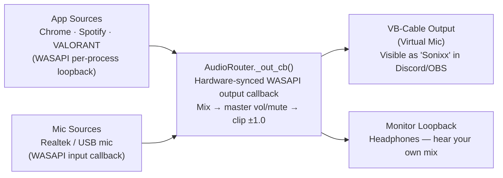
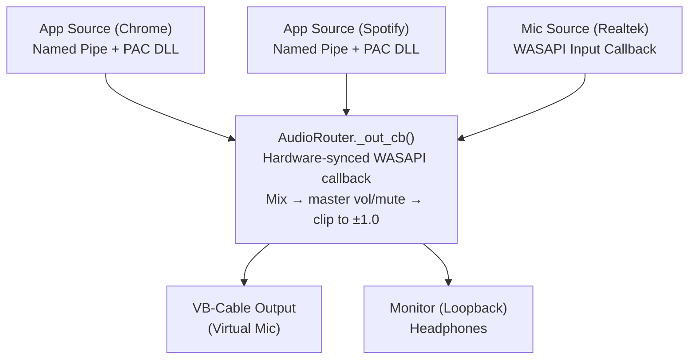
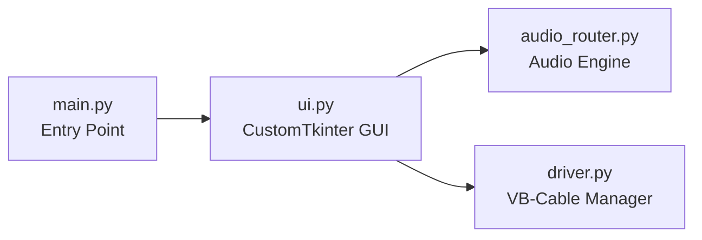

# Sonixx — Technical Manual

> **Sonixx** is a high-performance virtual audio router for Windows. It captures live audio from individual applications and physical microphones, mixes them in real-time using hardware-synced WASAPI callbacks, and routes the result to a single virtual microphone (VB-Cable). Unlike traditional soundboards that play pre-recorded files, Sonixx routes **live audio streams** — allowing you to send Spotify, browser audio, game sounds, or any app's output directly into Discord, VALORANT, OBS, or Zoom, alongside your real microphone.

---

## Table of Contents

1. [How It Works — The Big Picture](#how-it-works--the-big-picture)
2. [Audio Routing Architecture](#audio-routing-architecture)
3. [Core Modules](#core-modules)
4. [Audio Engine Deep Dive](#audio-engine-deep-dive)
5. [Per-Process Audio Capture (AppAudioSource)](#per-process-audio-capture-appaudiosource)
6. [Microphone Capture (MicSource)](#microphone-capture-micsource)
7. [The Mixer (AudioRouter)](#the-mixer-audiorouter)
8. [Jitter Buffer](#jitter-buffer)
9. [VB-Cable and Driver Management](#vb-cable-and-driver-management)
10. [UI Layer](#ui-layer)
11. [Configuration and Persistence](#configuration-and-persistence)
12. [Building a Standalone Executable](#building-a-standalone-executable)
13. [Full Usage Walkthroughs](#full-usage-walkthroughs)
14. [Troubleshooting Reference](#troubleshooting-reference)
15. [Technology Stack](#technology-stack)
16. [Project Summary](#project-summary)

---

## How It Works — The Big Picture



<details>
<summary>ASCII fallback (click to expand)</summary>

```
App Sources (Chrome, Spotify, etc.)  ──┐
  Named Pipe + PAC DLL                 ├──► AudioRouter._out_cb()  ──► VB-Cable Output (Virtual Mic)
Mic Sources (Realtek)                ──┘    Hardware-synced WASAPI      (shown as "Sonixx" in apps)
  WASAPI Input Callback                     Mix → vol/mute → clip        └──► Monitor (Headphones)
```

</details>

---

## Audio Routing Architecture



<details>
<summary>ASCII fallback (click to expand)</summary>

```
┌──────────────────────────────────────────────────────┐
│                   Sonixx Application                 │
│                                                      │
│  ┌────────────┐   ┌────────────┐   ┌──────────────┐  │
│  │ App Source │   │ App Source │   │  Mic Source  │  │
│  │ (Chrome)   │   │ (Spotify)  │   │  (Realtek)   │  │
│  │ Named Pipe │   │ Named Pipe │   │ WASAPI Input │  │
│  │ + PAC DLL  │   │ + PAC DLL  │   │ (Callback)   │  │
│  └─────┬──────┘   └─────┬──────┘   └──────┬───────┘  │
│        └────────┬────────┘                │          │
│           ┌─────▼────────────────────────▼────┐      │
│           │      AudioRouter._out_cb()        │      │
│           │  Mix → master vol/mute → clip ±1.0│      │
│           └────────┬──────────────┬───────────┘      │
│            ┌───────▼───┐   ┌──────▼───────┐          │
│            │ VB-Cable  │   │   Monitor    │          │
│            │ (Virtual  │   │  Headphones  │          │
│            │   Mic)    │   │              │          │
│            └───────────┘   └──────────────┘          │
└──────────────────────────────────────────────────────┘
```

</details>

---

## Core Modules

| Module | File | Lines | Role |
|---|---|---|---|
| **Entry Point** | `main.py` | ~30 | Admin elevation via `ShellExecuteW`; launches UI |
| **GUI** | `app/ui.py` | 538 | CustomTkinter interface — source panels, output controls, system tray, settings |
| **Audio Engine** | `app/audio_router.py` | 481 | `AppAudioSource`, `MicSource`, `AudioRouter` — the full mixing pipeline |
| **Driver Manager** | `app/driver.py` | 173 | VB-Cable detection, silent install, registry rename, Windows autostart |

### Module Dependency



<details>
<summary>ASCII fallback (click to expand)</summary>

```
main.py ──► ui.py ──► audio_router.py
                 └──► driver.py
```

</details>

---

## Audio Engine Deep Dive

All audio processing lives in `app/audio_router.py`. There are three classes:

| Class | Role |
|---|---|
| `AppAudioSource` | Reads live audio from a Windows application process via `process-audio-capture` named pipes |
| `MicSource` | Reads from a physical microphone using a PyAudio WASAPI input stream |
| `AudioRouter` | Opens the VB-Cable output stream, runs the hardware-synced output callback, and mixes all sources |

---

## Per-Process Audio Capture (AppAudioSource)

Windows does not natively expose per-application audio to Python. Sonixx uses the `process-audio-capture` package, which injects a PAC DLL into the target process and communicates audio data back via a **named pipe**.

```
Target process (Chrome)
    └── PAC DLL injected
          └── Captures audio from Windows Audio Session API (WASAPI)
                └── Writes float32 PCM frames to named pipe
                      └── AppAudioSource reads pipe → numpy float32 array
```

### Key parameters

| Parameter | Value | Notes |
|---|---|---|
| **Sample rate** | 48000 Hz | Matched to output device |
| **Channels** | 2 (stereo) | Mono inputs are upmixed |
| **Format** | float32 | IEEE 754 — no int conversion needed |
| **Buffer** | 10 chunks (~210ms) | Jitter buffer — see below |

---

## Microphone Capture (MicSource)

`MicSource` opens a PyAudioWPatch WASAPI input stream in callback mode:

```python
stream = pa.open(
    format=pyaudio.paFloat32,
    channels=1,            # or 2 for stereo mics
    rate=48000,
    input=True,
    input_device_index=device_index,
    stream_callback=self._mic_callback,
    frames_per_buffer=chunk_size,
)
```

**Mono → Stereo upmix:** Single-channel mic data is automatically duplicated to both L and R channels before being added to the mix, ensuring consistent stereo output.

---

## The Mixer (AudioRouter)

`AudioRouter._out_cb()` is a **WASAPI output callback** — it runs on the audio hardware thread, called at precise intervals dictated by the output device's clock.

### Mixing Process (per callback invocation)

```
1. Initialize output_buffer = np.zeros(frames × 2, dtype=float32)

2. For each enabled AppAudioSource:
   a. Pull chunk from its jitter buffer
   b. Multiply by source.volume (0.0 – 2.0)
   c. Add to output_buffer

3. For each enabled MicSource:
   a. Pull latest chunk from mic callback buffer
   b. Multiply by source.volume
   c. Add to output_buffer

4. Multiply output_buffer by master_volume
5. If master_muted: output_buffer *= 0
6. Clip: output_buffer = np.clip(output_buffer, -1.0, 1.0)
7. Write output_buffer to VB-Cable output stream
8. If monitor_enabled: write output_buffer to headphone monitor stream
```

The `np.clip` step prevents hard digital clipping when multiple high-volume sources are mixed.

---

## Jitter Buffer

Each `AppAudioSource` maintains a deque of size 10 (approx. 210ms at 48kHz / 1024-frame chunks). This buffer absorbs OS scheduling jitter — if the source's pipe doesn't deliver a chunk on exactly the right millisecond, the buffer ensures the output callback always has data to consume.

| Parameter | Value |
|---|---|
| **Buffer size** | 10 chunks |
| **Chunk size** | 1024 frames |
| **Latency introduced** | ~210ms |
| **Purpose** | Prevents underruns and crackling from scheduling delays |

---

## VB-Cable and Driver Management

`app/driver.py` handles the full VB-Cable lifecycle:

| Function | Description |
|---|---|
| `detect_vbcable()` | Scans `pyaudio` device list for a device named "CABLE Input" |
| `install_vbcable()` | Extracts `VBCABLE_Driver_Pack45.zip` to temp, runs `VBCABLE_Setup_x64.exe /S` silently |
| `rename_device(name)` | Modifies `HKEY_LOCAL_MACHINE\SOFTWARE\...` registry key to rename "CABLE Output" to `name` |
| `set_autostart(enabled)` | Adds/removes a `HKEY_CURRENT_USER\SOFTWARE\Microsoft\Windows\CurrentVersion\Run` entry |

> All registry operations require **Administrator** privileges. Sonixx requests elevation at startup via `ShellExecuteW("runas", ...)`.

---

## UI Layer

`app/ui.py` is a CustomTkinter application structured into panels:

### Panel Layout

```
┌──────────────────────────────────────────┐
│  Sonixx Header + Status Indicator        │
├──────────────────────────────────────────┤
│  Applications Panel                      │
│  [Scan Button]                           │
│  ┌────────────────────────────────────┐  │
│  │ [●] Chrome         vol──●──  🗑   │  │
│  │ [●] Spotify        vol──●──  🗑   │  │
│  └────────────────────────────────────┘  │
├──────────────────────────────────────────┤
│  Microphones Panel                       │
│  [Dropdown] [+ Add]                      │
│  ┌────────────────────────────────────┐  │
│  │ [●] Realtek Mic    vol──●──  🗑   │  │
│  └────────────────────────────────────┘  │
├──────────────────────────────────────────┤
│  Output Controls                         │
│  Master Volume ──●── [🔊] [▶ Start]     │
│  Loopback Device: [Dropdown]             │
│  [✓] Monitor Mix                         │
├──────────────────────────────────────────┤
│  Settings: [✓] Tray  [✓] Startup         │
│  [Rename to "Sonixx"]                    │
└──────────────────────────────────────────┘
```

### System Tray

When the window is closed with "Tray" enabled, Sonixx minimises to the system tray using `pystray`. The tray icon provides: **Open**, **Stop Router**, **Exit** menu items. Double-clicking the icon restores the window.

---

## Configuration and Persistence

Settings are saved to `%APPDATA%\Sonixx\settings.json`:

| Key | Type | Default | Description |
|---|---|---|---|
| `tray` | `bool` | `true` | Minimise to tray on window close |
| `startup` | `bool` | `false` | Add to Windows startup (registry) |
| `theme` | `string` | `"dark"` | UI theme (dark only currently) |

---

## Building a Standalone Executable

```bash
uv run pyinstaller SonixxAudioRouter.spec --noconfirm
# Output: dist/SonixxAudioRouter.exe
```

The spec file (`SonixxAudioRouter.spec`) bundles:
- `assets/` — logo, icon, SVGs
- `VBCABLE_Driver_Pack45.zip` — driver installer
- Hidden imports: `customtkinter`, `process_audio_capture`

The resulting EXE is fully self-contained — no Python, no `uv`, no separate installs needed.

---

## Full Usage Walkthroughs

### Walkthrough 1 — Route Spotify to Discord

**Goal:** Play Spotify music through your microphone in a Discord voice channel.

1. Open Spotify and start playing music.
2. Launch Sonixx (runs as Administrator automatically).
3. In the **Applications** panel, click **⟳ Scan**.
4. Toggle **Spotify** ON. Adjust volume to taste.
5. Click **▶ Start** — status shows `● Routing`.
6. In Discord Settings → Voice & Video → Input Device: select **"Sonixx"** (or **"CABLE Output"**).
7. Spotify audio now comes through your microphone in Discord.

### Walkthrough 2 — Mix Mic + Browser Audio

**Goal:** Send both your voice and a YouTube video's audio to OBS.

1. Open YouTube in Chrome and play a video.
2. In Sonixx → Applications → **⟳ Scan** → Toggle **Chrome** ON.
3. In Sonixx → Microphones → select your mic from dropdown → **+ Add** → Toggle ON.
4. Click **▶ Start**.
5. In OBS → Audio Source → Capture Device: select **"Sonixx"**.
6. Both your mic and the Chrome audio are now in OBS as a single source.

### Walkthrough 3 — Monitor Your Own Mix

**Goal:** Hear exactly what is being sent to the virtual mic.

1. In the Output section, enable **Monitor Mix**.
2. Select your headphone device as the loopback output.
3. Start routing — you'll hear the full mixed output in your headphones in real time.

---

## Troubleshooting Reference

| Problem | Solution |
|---|---|
| **VB-Cable not detected after install** | Reboot PC; check Sound Settings → Input Devices for "CABLE Output"; click "Refresh" in Sonixx setup |
| **No apps appear after scan** | Ensure the app is actively producing audio; audiodg.exe and Sonixx are auto-excluded |
| **Audio crackling / glitching** | Check that input and output devices share the same sample rate (default 48000 Hz); monitor CPU load |
| **Rename to "Sonixx" fails** | Must be running as Administrator; rename modifies HKLM registry |
| **UAC prompt keeps appearing** | By design — admin rights required; set `Run as administrator` on EXE shortcut to suppress |

---

## Technology Stack

| Technology | Purpose |
|---|---|
| **Python ≥ 3.13** | Application language |
| **CustomTkinter** | Modern dark-themed Tkinter UI framework |
| **PyAudioWPatch** | PyAudio fork with WASAPI loopback + callback support |
| **process-audio-capture** | Per-process audio capture via Windows DLL injection + named pipes |
| **numpy** | High-performance float32 audio buffer manipulation |
| **pycaw** | Python Core Audio Windows (COM) library |
| **psutil** | Process enumeration for app scan |
| **comtypes** | COM interface access for Windows audio APIs |
| **keyboard** | Global hotkey registration (`Ctrl+Alt+M`) |
| **pystray** | System tray icon + menu |
| **Pillow** | Image processing for UI assets |
| **tksvg** | SVG rendering in Tkinter |
| **PyInstaller** | Standalone EXE bundler (dev dependency) |
| **uv** | Fast Python package manager + lockfile |

---

## Project Summary

| Attribute | Value |
|---|---|
| **Type** | Windows desktop application |
| **Language** | Python 3.13 |
| **UI Framework** | CustomTkinter (dark theme) |
| **Audio Engine** | WASAPI (via PyAudioWPatch) + process-audio-capture |
| **Virtual Device** | VB-Cable (auto-installed) |
| **Mixing** | Hardware-synced callback — `np.add` + `np.clip` |
| **Latency** | ~210ms (jitter buffer); near-zero extra processing overhead |
| **Hotkey** | `Ctrl+Alt+M` — global master mute |
| **Config** | `%APPDATA%\Sonixx\settings.json` |
| **Distribution** | `dist/SonixxAudioRouter.exe` via PyInstaller |
| **Admin required** | Yes — VB-Cable install, registry rename, system audio hooks |
| **Platform** | Windows 10 / 11 only |
